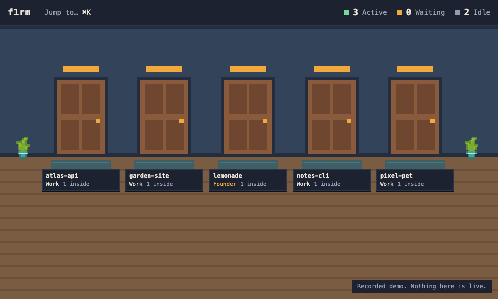

# f1rm

A pixel-art office for your Claude Code sessions. Every session on your Mac is an employee at a desk, in the office of the project it works on. You see who is working, reading, running a command, waiting for permission or on a coffee break. Someone shows as working only while their process is live and `claude agents` calls them busy or one of their hook events came in the last 90 seconds; otherwise they are idle, or offline once their process is gone. Click someone to jump to their terminal, ask them a question without interrupting them, or tell them something they read at their next step.

f1rm also ships a company: a Claude Code plugin with twelve roles (PM, Team lead, Designer, Frontend dev, Backend dev, Reviewer, Researcher and five Founder roles) and the guidelines they work by. You talk to the PM. The PM hires team leads, who hire the rest.



## What you get

- **A lobby with a door per project.** Each door shows how many people are inside and whether someone is waiting for you. A door appears when you run `f1rm pm` in a project, and not before; sessions in folders without one wait under Elsewhere. Enter a door to see that project's office full screen.
- **Live employees.** Sessions you start in any terminal arrive as freelancers. Sessions started as a role, such as `claude --agent f1rm:designer`, take that role's desk and shirt. Everyone gets a name of their own. Sub-agents walk out as interns and leave when they finish.
- **The PM's table.** The PM, the one you talk to, sits at its own table in a glass corner, with a chair for you. When its turn ends, a "?" over your chair says it is waiting for your answer, and its panel's Talk button takes you to its terminal. A tap on the empty table starts a PM.
- **Work or Founder.** Each project is a Work project (the engineering company) or a Founder project, which adds a Marketer, an SEO specialist, Social media, Sales and a Strategist for your own products. You choose the first time you open a project; they draft, and you publish.
- **Teams.** For a milestone with slices that can run in parallel, the PM forms up to two teams. Each team is a pod on its own rug, its Team lead at the head and a sign that carries the team's board. Leads hire their own specialists, at most two working at a time, and you talk to each lead in its own session (Jump); the PM only tells you which lead needs you.
- **Jump.** Click an employee and press Jump to bring their exact iTerm2 tab to the front. `⌘K` searches everyone by name, role, project or task.
- **Ask.** A side question is answered by a read-only copy of the employee's session. Their work is never touched.
- **Tell.** A message the employee reads at their next step, without stopping a running tool.
- **Approvals.** A hire's permission request waits for you in the office for 30 minutes, in a tray in the top bar and on the hire's desk, with the full command, who asks and why (the hire's last words). Approve once, Deny, or Always for this project, which adds exactly the allow rule Claude Code suggested for that request (the card shows it) to the repo's `.claude/settings.local.json`; with no suggestion there is no such button. A request nobody answers falls back to the hire's own prompt. A lead that waits on you, on a permission or an open question on its team board, is tagged "needs you".
- **Whiteboards.** Each project shows the PM's task board on the wall.

## Quick start

You need macOS, [Bun](https://bun.sh) 1.3 or later, and Claude Code 2.1.300 or later. iTerm2 is the terminal Jump knows best. A session in a VS Code terminal brings its VS Code window forward.

```sh
git clone https://github.com/feiteiradev/f1rm && cd f1rm
bun install && bun run build
bun office/cli/f1rm.ts install                 # f1rm's hooks (your settings backed up first) and the f1rm command in ~/.local/bin
claude plugin marketplace add feiteiradev/f1rm && claude plugin install f1rm@f1rm   # the company
```

If `f1rm` isn't found, add `~/.local/bin` to your PATH, or use `bun office/cli/f1rm.ts` in its place. Then run **`f1rm`** in your project folder. It starts the office in the background if it isn't running, and shows that project in your office tab, or opens one. Every Claude Code session you start appears in the office.

The office keeps running after you close Claude Code and starts again at login, so the hooks always reach it. After a `git pull`, run `f1rm service` to restart it on the new code. Its log is `~/.f1rm/office.log`. The office keeps the same link across restarts, in `~/.f1rm/link-key`; if the link leaks, `rm ~/.f1rm/link-key` and run `f1rm service`, and the next `f1rm` opens a new link. `f1rm uninstall` removes exactly what `install` added, and keeps your event log, boards and editions.

## Commands

`f1rm install` puts the `f1rm` command in `~/.local/bin`; if that folder isn't on your PATH, add it, or use `bun office/cli/f1rm.ts` in its place.

| Command | What it does |
| :- | :- |
| `f1rm` | Opens the office on this project: installs or updates the hooks if needed, starts the background office if it isn't running, and shows the project in your office tab, or opens one. Prints one line. |
| `f1rm install` | Adds f1rm's hooks to `~/.claude/settings.json`, after backing it up, and the `f1rm` command to `~/.local/bin`. |
| `f1rm uninstall` | Removes exactly what `install` added, the `f1rm` command included. Keeps your event log, boards and editions in `~/.f1rm/`. |
| `f1rm start` | Opens the office in your browser and exits. If the office isn't running, starts the background office first, as `f1rm service` does. `f1rm serve` runs one in this terminal instead, until you stop it. |
| `f1rm service` | Runs the office in the background and at login. Run it again to restart it on new code. |
| `f1rm service off` | Stops the background office and removes it from login. Your sessions keep working; the hooks just go quiet. |
| `f1rm edition` | Prints this repo's edition. `f1rm edition work` or `f1rm edition founder` changes it, once `f1rm pm` has been run in the repo (it never creates a door). |
| `f1rm pm` | Registers this repo, which gives it a door in the lobby, and starts its PM in this terminal. Extra flags go to `claude`, for example `f1rm pm --model sonnet`. |
| `f1rm hire` | Starts a lead or a specialist in the background. The PM and leads run it; `f1rm hire --help` shows the syntax. Flags before the role: `--skills a,b` adds skills for one task (`--skills research` starts a Researcher on `/research`; any `pstack:` skill other than `pstack:poteto-mode` (devs only), `pstack:architect` and `pstack:how` (leads only) is refused, and a code Reviewer refuses a slash-only skill), `--level low\|medium\|high` sets the Reviewer's `/code-review` level (`high` also runs `security-review` on the merge), and `--content` starts a cheap Sonnet Reviewer for a branch with no code. Every hire but a lead starts at ponytail `full`, a lead at your ponytail default. |
| `f1rm letgo` | `f1rm letgo <name>...` lets finished hires go: stops them, removes them, and deletes their worktree and branch when the branch is merged. The PM and leads run it after `APPROVED`. |
| `f1rm wake` | `f1rm wake <name\|id> [message]` resumes a stopped, blocked or done hire (or lead) of this project in the background, in its own worktree, with its history, name and report line. It counts against the caps like a hire. The PM wakes leads and a lead its own team's members. A message to a hire with no live process is refused with `no live session; f1rm wake <name>`. The office runs it by itself, once per stop, for hires and leads of a registered project that stopped on the session limit (a minute after the reset) or lost their process (an update, a crash) while their board row is `doing` or `review`; when it cannot, it tells the session they report to. |
| `f1rm pause` | `f1rm pause [reason...]` pauses this project: the office answers every hook of its hires with `continue:false`, so each stops at its next step, and 30 s later `claude stop` ends any still busy (conversation and worktree kept, never removed). While paused the office wakes, nudges and reports nothing for it, `f1rm wake` is refused, and `f1rm status` says `PAUSED`. The PM runs it for its own project; `--all` pauses every project and is for your terminal only. The flag lives in `~/.f1rm/paused/`, so a restart keeps it. |
| `f1rm resume` | `f1rm resume [--all]` clears the pause and, one hire at a time, tells the ones the pause halted whose process lives and wakes the ones whose process ended (only those whose board row is `doing` or `review`), within the cap of 8, waiting for a free slot. |
| `f1rm status` | `f1rm status [--json]` lists this repo's hires and what each is really doing: the last write to its transcript, the last commit on its branch, whether it ended, when a usage-limit stop lifts, and what the office's recovery noted (NOTE). It never trusts `claude agents`' status text, and `f1rm status --watch <names>` is what the PM and leads run in the background to watch their hires. |
| `f1rm report` | `f1rm report <KIND> <slug> [--commit <sha>] [--note "<one line>"]` is how a hire reports besides its message (`SendMessage` can return success and never arrive): it writes `~/.f1rm/evidence/<repo>/<slug>/report.json` with a rising `seq`, `f1rm status --watch` wakes the lead once per new `seq`, `f1rm status` shows it in its REPORT column, and the office counts it as a delivered report. KIND is DONE, APPROVED, CHANGES, BLOCKED or ESCALATE. |
| `f1rm demo` | Opens the recorded demo, with no server and no Claude Code. Needs `bun run build` first. |
| `f1rm serve` | Runs the office server in the foreground. This is what `service` runs. |

## The company

Start a PM in the repo you want to work on: run `f1rm pm` in a terminal in that folder.

The PM picks the workflow by rule and says it in one line: it does ops (no file changes) at once, runs a simple one-deliverable request with one lead and one short brief, and says "Simple workflow: ..." when it does; say "milestone" to upgrade it. For a milestone it interviews you, writes the task board, and hires only team leads with `f1rm hire`: every milestone runs through one or two teams, even a one-task milestone. Each lead hires its own specialists, at most two working at a time, asks you its decisions as a numbered round with a recommended answer, checks their work and sends the PM only `NEEDS YOU` and `DONE`. Each hire runs as a background session in its own git worktree. At most 8 background sessions work at once unless you approve more. The PM speaks up only for a big decision (business, product scope, design direction, strategy, an irreversible or external action; technical choices are made and logged for you, and the end-of-milestone report lists them under "Decisions taken without you"), something only you can do (a permission, spend, credentials, a `git push`), and one report at the end of the milestone; ask "status?" for more. The Reviewer runs in the repo itself, checks every change on a scratch copy, sends back only blocking findings (the rest are fixed in one batch task at the end of the milestone), and is the only one who merges, locally. Only you push. [`plugin/README.md`](plugin/README.md) has the details, and the `f1rm-guidelines` skill holds the rules the roles follow, including each role's [Workflows](plugin/skills/f1rm-guidelines/SKILL.md#workflows).

You can also hire from the office: the Hire button in a project, or a click on an empty desk, opens a dialog with the plugin's roles. Pick one, write a brief, and it starts the same way `f1rm hire` does. In a project with a PM, "Let the PM decide" sends your brief to them as a message instead. In one without, "Start PM" opens an iTerm tab in the repo running `f1rm pm`.

## Demo

`bun run build` builds a demo into `office/demo/dist`. It is plain static files: a recorded office session replayed in the browser, with no f1rm server and no Claude Code.

- Try it locally: `bun office/cli/f1rm.ts demo`, or serve the folder with any static file server, for example `python3 -m http.server -d office/demo/dist`.
- Deploy it: upload the contents of `office/demo/dist` to any static host (GitHub Pages, Netlify, Cloudflare Pages, Vercel as a static site). Its assets use relative paths, so it works from a sub-path. Nothing is deployed from this repo for you.
- Re-record it: `bun run record-demo` runs the real server against a temporary HOME, plays `office/demo/scenario.ts` into it and writes the scrubbed log to `office/demo/fixture.json`. The scrub step (`office/demo/scrub.ts`) removes prompts, command and search arguments, absolute paths, private titles and secret-shaped strings, and refuses to write a fixture that still looks private. Read the fixture before you commit a new one.

## Security

The office can steer your sessions, so it is locked to you.

- The server listens on `127.0.0.1` only.
- The browser needs a fresh token on every launch. `start` prints the URL that carries it.
- Hooks need a separate secret written at install time. Every hook reads it from a file only you can read, so it never shows up in the process list. The hooks are quiet `curl` calls: with the office stopped they do nothing, and your sessions show no errors.
- Every request has its `Host` and `Origin` checked, and the server sends no CORS headers.
- Approvals show the full command before the Approve button, and each approval answers exactly one request. Only your browser answers: a session's call to the approve, deny or always routes is refused.

## Development

`bun run check` runs the tests, the typecheck and both builds, behind a per-repo lock (`scripts/check-lock.ts`): only one suite runs per repo at a time, a second caller waits and prints who holds it, and a lock whose holder died is taken over. `bun test <file>` stays unlocked. The `scripts/` folder holds the browser proofs (`lobby-proof.mjs`, `office-proof.mjs`, `jump-proof.mjs` and others) and `smoke.ts`, which re-checks the Claude Code behaviour f1rm relies on after an upgrade. `record-gif.mjs` re-records `docs/f1rm.gif` from the demo build.

## Credits

The office art is CC0 from Kenney, plus pixels drawn in code. See [CREDITS.md](CREDITS.md). f1rm is MIT licensed.
